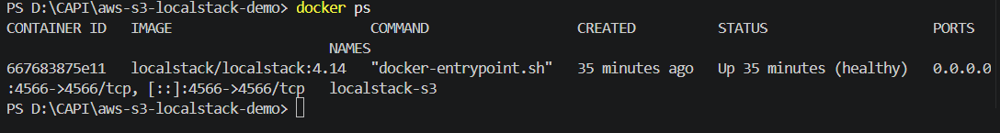
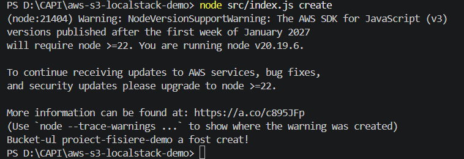
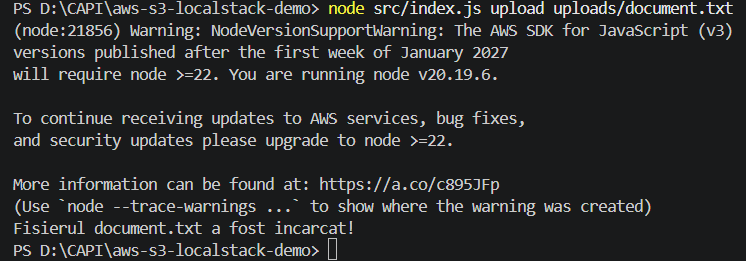
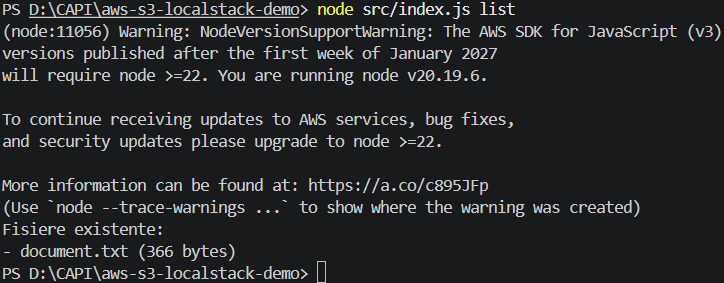
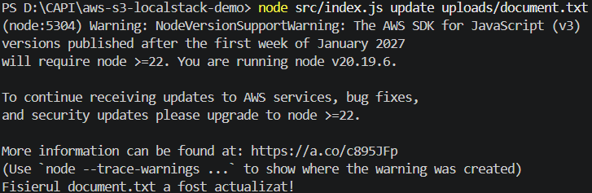
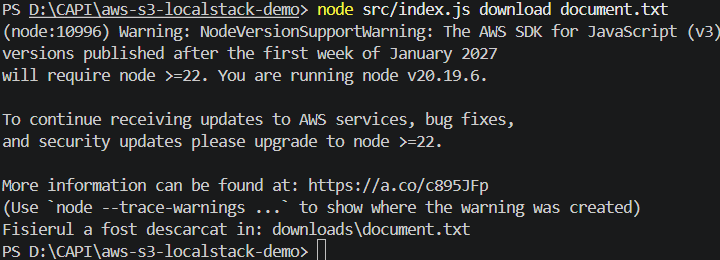
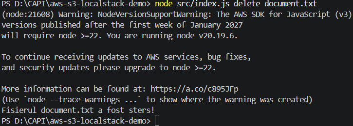

# AWS S3 LocalStack Demo

## 1. Descrierea proiectului

Acest proiect reprezinta un prototip functional pentru demonstrarea utilizarii serviciului Amazon S3 folosind LocalStack, Docker si JavaScript (Node.js).

Aplicatia permite gestionarea fisierelor prin intermediul unui bucket S3 simulat local.

Proiectul demonstreaza operatiunile CRUD:

- Create - crearea unui bucket si incarcarea fisierelor.
- Read - listarea si descarcarea fisierelor.
- Update - actualizarea continutului unui fisier.
- Delete - stergerea fisierelor si a bucket-ului.

## 2. Tehnologii utilizate

- JavaScript
- Node.js
- npm
- Docker
- Docker Compose
- LocalStack
- Amazon S3
- AWS SDK for JavaScript v3

## 3. Structura proiectului

```text
aws-s3-localstack-demo/
│
├── src/
│   ├── s3.js
│   └── index.js
│
├── uploads/
│   └── document.txt
│
├── screenshots/
│   ├── 01-localstack.png
│   ├── 02-create-bucket.png
│   ├── 03-upload.png
│   ├── 04-list.png
│   ├── 05-update.png
│   ├── 06-download.png
│   └── 07-delete.png
│
├── docker-compose.yml
├── package.json
├── package-lock.json
├── README.md
└── .gitignore
```

## 4. Cerinte preliminare

Pentru rularea proiectului sunt necesare:

- Node.js 22 sau o versiune compatibila.
- npm.
- Docker Desktop.
- Docker Compose.
- Git (optional, pentru clonarea repository-ului).

## 5. Instalarea proiectului

Clonarea repository-ului:

```bash
git clone https://github.com/Chira-MP/aws-s3-localstack-demo.git
```

Accesarea folderului:

```bash
cd aws-s3-localstack-demo
```

Instalarea dependintelor:

```bash
npm install
```

## 6. Pornirea LocalStack

Pornirea containerului:

```bash
docker compose up -d
```

Verificarea containerului:

```bash
docker ps
```

Verificarea starii serviciilor:

```powershell
Invoke-RestMethod http://localhost:4566/_localstack/health
```

## 7. Configurarea conexiunii S3

Aplicatia utilizeaza urmatoarea configuratie:

- Endpoint: http://localhost:4566
- Region: us-east-1
- Access Key: test
- Secret Key: test
- Bucket: proiect-fisiere-demo

Credentialele sunt utilizate exclusiv pentru mediul local de testare.

## 8. Utilizarea aplicatiei

### 8.1. Crearea unui bucket

```bash
node src/index.js create
```

### 8.2. Incarcarea unui fisier

```bash
node src/index.js upload uploads/document.txt
```

### 8.3. Actualizarea unui fisier

```bash
node src/index.js update uploads/document.txt
```

Fisierul trebuie sa existe deja in bucket. Continutul sau va fi inlocuit cu cel din fisierul local.

### 8.4. Listarea fisierelor

```bash
node src/index.js list
```

### 8.5. Descarcarea unui fisier

```bash
node src/index.js download document.txt
```

Fisierul va fi salvat in folderul downloads.

### 8.6. Stergerea unui fisier

```bash
node src/index.js delete document.txt
```

### 8.7. Stergerea bucket-ului

Bucket-ul trebuie sa fie gol inainte de stergere.

```bash
node src/index.js delete-bucket
```

## 9. Capturi de ecran

### Pornirea LocalStack



### Crearea bucket-ului



### Incarcarea fisierului



### Listarea fisierelor



### Actualizarea fisierului



### Descarcarea fisierului



### Stergerea fisierului



## 10. Oprirea LocalStack

Pentru oprirea containerului:

```bash
docker compose down
```

Pentru stergerea inclusiv a volumului persistent:

```bash
docker compose down -v
```

Atentie: ultima comanda sterge datele persistente ale LocalStack.

## 11. Concluzii

Proiectul demonstreaza integrarea si utilizarea serviciului Amazon S3 intr-un mediu local, prin intermediul LocalStack.

Prin implementarea aplicatiei au fost demonstrate operatiunile de creare, citire, actualizare si stergere a fisierelor.

Utilizarea Docker si LocalStack permite testarea functionalitatilor unui serviciu AWS fara a necesita utilizarea infrastructurii AWS reale.

## 12. Repository GitHub

Codul sursa si documentatia proiectului sunt disponibile public la:

https://github.com/Chira-MP/aws-s3-localstack-demo
